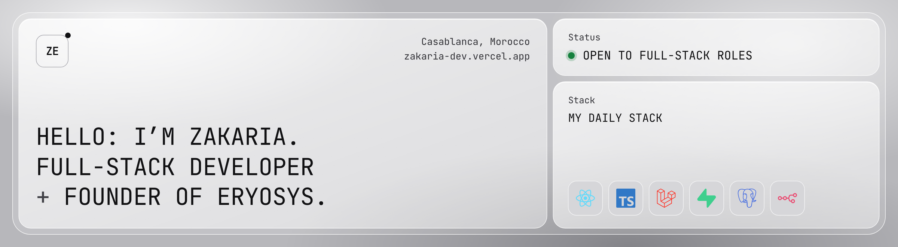

<picture>
  <source media="(prefers-color-scheme: dark)" srcset="./header-dark.png">
  
</picture>

  <a href="https://zakaria-dev.vercel.app"><b>Portfolio</b></a> ·
  <a href="https://www.linkedin.com/in/er-rahmouny-zakaria"><b>LinkedIn</b></a> ·
  <a href="mailto:errahmounizakaria99@gmail.com"><b>Email</b></a> ·
  <a href="https://zakaria-dev.vercel.app/Zakaria_Errahmouni_Developpeur_FullStack.pdf"><b>CV (PDF)</b></a>

Full-stack developer in Casablanca. I build web apps and SaaS from idea to production with **React, TypeScript, Laravel and Supabase**.

**Open to full-stack roles** · on-site, hybrid or remote.

## Featured work

| Project | What it is | Stack | Links |
|---|---|---|---|
| **ERYO Finance** | Personal finance PWA in Darija, French and English (RTL) | React · TypeScript · Supabase | [Live](https://finance.eryosys.com) · [Case study](https://zakaria-dev.vercel.app/projects/eryo-finance) |
| **ERYOSYS** | Multi-tenant SaaS for gaming lounges: tenant isolation, roles, audit trail | PostgreSQL · CI | [Case study](https://zakaria-dev.vercel.app/projects/eryosys) |
| **CGS Maroc** | Bilingual B2B website with admin panel and article approval | TypeScript · PHP | [Live](https://www.cgsmaroc.com/) · [Case study](https://zakaria-dev.vercel.app/projects/cgs-maroc) |
| **GMAO · CIMC Tianda** | Maintenance app for airport boarding bridges and 400 Hz GPUs | Laravel · MySQL | [Case study](https://zakaria-dev.vercel.app/projects/gmao-cimc-tianda) |
| **ERYO Lounge** | System that runs a gaming lounge every day | Google Apps Script | [Case study](https://zakaria-dev.vercel.app/projects/eryo-lounge) |
| **n8n automations** | Daily lounge reports sent to Telegram | n8n · Gmail API | [Case study](https://zakaria-dev.vercel.app/projects/n8n-automations) |

Most product and client code is private. Each case study shows the screens and what I built.

## Stack

**How I work:** Git and GitHub, CI, automated tests, row-level security, PWA, i18n and RTL.

## Languages

Arabic and Darija (native) · French (fluent) · English (fluent) · German (basics)
